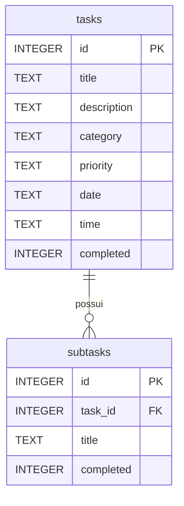

# CanDo

## Sobre o app

O **CanDo** é um aplicativo mobile de organização de tarefas diárias. O usuário pode cadastrar as tarefas que deseja realizar, organizá-las por categoria e prioridade e acompanhar seu progresso ao longo do dia.

A proposta do aplicativo é oferecer uma experiência simples e intuitiva para ajudar o usuário a visualizar suas atividades, controlar o que já foi realizado e dividir tarefas maiores em **subtarefas**, facilitando o acompanhamento do progresso. Todos os dados ficam salvos no próprio aparelho (SQLite), sem necessidade de internet.

### Funcionalidades essenciais

* [x] Criar tarefa
* [x] Listar e visualizar tarefas
* [x] Marcar tarefa como concluída
* [x] Definir categoria para a tarefa
* [x] Definir prioridade da tarefa
* [x] Criar, nomear e excluir subtarefas dentro de uma tarefa
* [x] Marcar subtarefas como concluídas
* [x] Visualizar o progresso diário
* [x] Visualizar o progresso das subtarefas
* [x] Persistir tarefas e subtarefas no banco de dados (SQLite)
* [x] Editar tarefa
* [x] Excluir tarefa
* [x] Definir data e horário para a tarefa
* [x] Validar os campos dos formulários

### Funcionalidades adicionais

* [x] Criar categorias personalizadas
* [x] Listar todas as tarefas agrupadas por dia, com filtros por status
* [x] Tela de progresso (resumo, taxa de conclusão, produtividade semanal e progresso por categoria)
* [x] Tela de perfil (resumo, ajuda, avaliar, compartilhar e excluir tarefas concluídas)
* [ ] Histórico detalhado de tarefas concluídas
* [ ] Notificações e lembretes
* [ ] Tema escuro
* [ ] Login e cadastro de usuários

## Download do APK

O APK de instalação para Android está disponível na página de [Releases do repositório](https://github.com/larigm/can-do/releases).

Para instalar: baixe o arquivo `.apk` no celular, abra-o e autorize a instalação de fontes desconhecidas.

## Protótipos de tela

Os protótipos do **CanDo** foram desenvolvidos no Figma, seguindo um Design System próprio, com definição de cores, tipografia, espaçamentos, componentes e estados da interface.

[Protótipos - CanDo (Figma)](https://www.figma.com/design/LBz7bRwmiWOFjMUBxhAk5m/CanDo?node-id=0-1&t=MYgJB43Y0SSDIezh-1)

### Telas essenciais

Telas necessárias para o funcionamento do app (cadastrar, visualizar, editar e acompanhar tarefas):

* [x] Hoje (`app/index.tsx`)
* [x] Hoje: estado vazio (componente `EmptyState`)
* [x] Nova tarefa (`app/new-task.tsx`)
* [x] Detalhes da tarefa (`app/task-details.tsx`)
* [x] Editar tarefa (`app/new-task.tsx` reaproveitado em modo edição)

### Telas não essenciais

Telas do protótipo que complementam a experiência, mas o app funciona sem elas:

* [x] Todas as tarefas (`app/tasks.tsx`)
* [x] Progresso (`app/progress.tsx`)
* [x] Perfil (`app/profile.tsx`), adaptado a um app sem conta de usuário
* [ ] Splash Screen
* [ ] Login
* [ ] Cadastro

### Fluxo principal

```text
Hoje
   ↓
Nova tarefa
   ↓
Preencher tarefa (categoria, prioridade, data, horário e subtarefas)
   ↓
Adicionar tarefa
   ↓
Tarefa aparece na lista do dia
   ↓
Detalhes da tarefa (editar, excluir e gerenciar subtarefas)
   ↓
Marcar tarefa ou subtarefas como concluídas
   ↓
Progresso atualizado (telas Hoje, Tarefas, Progresso e Perfil)
```

## Modelagem do banco de dados (SQLite)

O aplicativo utiliza um banco de dados local **SQLite** (via `expo-sqlite`) para armazenar as tarefas e suas respectivas subtarefas. Não há backend: todos os dados ficam no dispositivo.



> No SQLite não existem tipos `DATE` e `BOOLEAN` nativos: datas são guardadas como `TEXT` (formato `AAAA-MM-DD`) e booleanos como `INTEGER` (0 ou 1).

> Os nomes das tabelas e colunas foram padronizados em inglês, igual ao código (`tasks`, `subtasks`, `title`...). A estrutura é a mesma planejada inicialmente. A única diferença é o relacionamento: `ON DELETE CASCADE` em `subtasks.task_id`, para apagar as subtarefas junto com a tarefa.

> As categorias personalizadas não têm tabela própria: são lidas das próprias tarefas salvas (`SELECT DISTINCT category`), o que mantém a modelagem simples.

## Estrutura do projeto

```text
app/            telas e rotas (Expo Router)
components/     componentes reutilizáveis (TaskCard, WeekDaySelector, BottomTabBar...)
constants/      tokens de tema (cores, raios, tamanhos e fontes)
database/       schema do SQLite e funções de acesso ao banco
hooks/          hooks que isolam o banco das telas (useTasks, useTask, useCategories)
styles/         estilos de cada tela, usando o tema
types/          tipos do TypeScript (Task, Subtask)
utils/          funções de data
```

## Atualizações desde o último checkpoint

Depois da base visual com dados fake, o CanDo passou a ser um aplicativo completo e funcional: os dados são salvos em SQLite, o CRUD está implementado, os formulários têm validações e foram criadas as telas de Tarefas, Progresso e Perfil. Também foi gerado o APK com EAS Build.

### Recursos aplicados dos módulos anteriores

* **Expo Router:** rotas em `app/`, navegação com `useRouter`, parâmetros com `useLocalSearchParams` (id da tarefa) e `useFocusEffect` para recarregar os dados quando a tela volta ao foco.
* **SQLite (`expo-sqlite`):** banco local com `SQLiteProvider`, criação das tabelas na primeira abertura e controle de versão com `PRAGMA user_version`.
* **Hooks customizados:** `useTasks`, `useTask` e `useCategories` isolam o acesso ao banco, e as telas não conhecem SQL.
* **TypeScript:** tipagem do modelo de dados e das props dos componentes.
* **Google Fonts (Inter) e Expo Vector Icons:** tipografia do Figma e ícones de navegação, status e botões.
* **Theme / Design Tokens:** cores, raios, tamanhos e fontes centralizados em `constants/theme.ts` e aplicados nos estilos das telas (`styles/`).
* **APIs nativas do React Native:** `Alert` (confirmações), `Linking` (abrir links) e `Share` (compartilhamento nativo).
* **EAS Build:** geração do APK para Android.

### Boas práticas na criação de componentes

* **Responsabilidade Única (SRP):** cada componente tem apenas uma função visual isolada (ex: `TaskCard` para tarefas, `DailyProgressCard` para o progresso, `EmptyState` para estado vazio).
* **Componentes Apresentacionais:** recebem dados e emitem ações via `props` (`onPress`, `onToggleComplete`), sem regra de negócio embutida.
* **Reutilização:** o mesmo `TaskCard` aparece nas telas Hoje e Tarefas, e a tela de Nova tarefa também serve para editar. O `MenuRow` repete o mesmo layout nas opções do Perfil.
* **Props Tipadas com TypeScript:** uso de `interfaces` em cada componente.
* **Separação de responsabilidades:** rotas (`app/`), componentes, banco (`database/`), hooks, estilos (`styles/`), tema (`constants/`), tipos e utilitários em pastas próprias.

## Planejamento de sprints

O desenvolvimento do **CanDo** foi organizado em 8 sprints. As sprints 1 a 6 foram concluídas, e as demais seguem o cronograma:

| Sprint | Período | Duração | Foco |
|---|---|---|---|
| 4 | 02/11 a 08/11 | 1 semana | Persistência com SQLite (concluída) |
| 5 | 09/11 a 15/11 | 1 semana | Editar, excluir e validações (concluída) |
| 6 | 16/11 a 25/11 | 10 dias | Estilos pendentes e telas complementares (concluída) |
| 7 | 25/11 a 27/11 | 3 dias | Testes e build do APK |
| 8 | 27/11 a 28/11 | 2 dias | Card de destaques, vídeo e entrega |

### Sprint 1: Planejamento e prototipação (concluída)
* [x] Definir as funcionalidades essenciais do aplicativo
* [x] Definir o fluxo de navegação
* [x] Criar as telas principais no Figma seguindo Design System
* [x] Criar o protótipo interativo
* [x] Revisar a experiência de navegação

### Sprint 2: Estrutura inicial e roteamento (concluída)
* [x] Criar o projeto utilizando Expo e TypeScript
* [x] Configurar o repositório GitHub com branch main e fluxo de PRs
* [x] Configurar o Expo Router com `app/_layout.tsx`
* [x] Configurar tipografia Inter com `@expo-google-fonts/inter`
* [x] Organizar a estrutura de pastas do projeto

### Sprint 3: Composição de telas e componentes reutilizáveis (concluída)
* [x] Desenvolver a tela inicial **Hoje** (`app/index.tsx`)
* [x] Implementar componentes reutilizáveis na pasta `components/`
* [x] Desenvolver a tela **Nova Tarefa** (`app/new-task.tsx`) com formulário e subtarefas
* [x] Desenvolver a tela **Detalhes da Tarefa** (`app/task-details.tsx`) com subtarefas interativas
* [x] Popular as 3 telas com dados mockados
* [x] Implementar navegação funcional de ida e volta entre as 3 telas
* [x] Definir o título (`title`) de cada tela no `Stack.Screen`
* [x] Passar o `id` da tarefa para a tela **Detalhes** pela rota (`useLocalSearchParams`)
* [x] Criar os tokens de tema (`constants/theme.ts`) e aplicá-los na tela de detalhes (`styles/taskDetails.styles.ts`)

### Sprint 4: Persistência com SQLite (concluída)
* [x] Gerar a data e a semana da tela **Hoje** a partir de `new Date()`
* [x] Usar o tema (`colors.primary`) no `_layout.tsx` em vez de cores fixas
* [x] Instalar e configurar o `expo-sqlite`
* [x] Criar as tabelas `tasks` e `subtasks`
* [x] Criar a camada de acesso ao banco (`database/`) com funções de listar, criar e concluir
* [x] Criar hooks (`useTasks` e `useTask`) para isolar o acesso ao banco das telas
* [x] Conectar a tela **Hoje** ao banco (substituir `MOCK_TASKS`)
* [x] Conectar a tela **Nova Tarefa** ao banco
* [x] Carregar os dados da tela **Detalhes** a partir do banco, usando o `id` da rota
* [x] Persistir a conclusão de tarefas e subtarefas

### Sprint 5: Editar, excluir e validações (concluída)
* [x] Criar a tela **Editar Tarefa** reaproveitando o formulário de Nova Tarefa
* [x] Implementar a exclusão de tarefas (com confirmação)
* [x] Incluir data e horário no formulário e no banco
* [x] Validar os campos dos formulários (nome, descrição, categoria, horário e subtarefas) com mensagens de erro
* [x] Atualização reativa da barra de progresso diário

### Sprint 6: Estilos pendentes e telas complementares (concluída)
* [x] Aplicar os tokens de tema e mover os estilos das telas **Hoje** e **Nova Tarefa** para `styles/`
* [x] Mostrar o ponto do seletor de semana apenas nos dias que têm tarefa
* [x] Desenvolver a tela **Todas as tarefas** (agrupamento por dia e filtros por status)
* [x] Desenvolver a tela **Progresso**
* [x] Desenvolver a tela **Perfil**, adaptada a um app sem conta de usuário
* [ ] Desenvolver a tela **Splash Screen** (ver justificativas)
* [ ] Desenvolver as telas **Login** e **Cadastro** (ver justificativas)
* [ ] Implementar animações e feedback visual avançado (ver justificativas)

Tarefas que surgiram durante a sprint e não estavam previstas:

* [x] Filtrar a tela **Hoje** pelo dia selecionado na semana
* [x] Exibir a saudação conforme o horário (Bom dia, Boa tarde ou Boa noite)
* [x] Dar função aos botões de configurações e opções (engrenagem e menu da tarefa)
* [x] Permitir nomear e excluir subtarefas na tela de detalhes
* [x] Permitir criar categorias personalizadas
* [x] Corrigir a navegação do menu inferior

### Sprint 7: Testes, build e estabilização (25/11 a 27/11)
* [x] Configurar o EAS Build (`eas.json`, pacote Android e `scheme`) e gerar um APK de teste
* [x] Alinhar as dependências do Expo ao SDK 58 (`expo-doctor`)
* [x] Testar o fluxo completo de tarefas e subtarefas no APK de teste
* [x] Corrigir os problemas encontrados no teste (nomear subtarefas e criar categorias)
* [ ] Testar a persistência dos dados ao reabrir o app
* [ ] Validar com `npx tsc --noEmit`
* [ ] Gerar o APK final com EAS Build
* [ ] Publicar o APK como Release no GitHub

### Sprint 8: Finalização e entrega (27/11 a 28/11)
* [x] Remover o arquivo de mocks, que não é mais usado
* [x] Atualizar a documentação (marcar tarefas e justificar o que não foi feito)
* [ ] Gerar o card de destaques do app
* [ ] Gravar o vídeo final de apresentação
* [ ] Entregar a versão final do aplicativo

## Tarefas não implementadas e justificativas

* **Login e Cadastro:** o aplicativo guarda todos os dados localmente no dispositivo (SQLite), sem backend, então não há contas de usuário para autenticar. Para suportá-los seria necessário um servidor ou um serviço como o Firebase, o que mudaria a arquitetura planejada.
* **Splash Screen personalizada:** a tela de abertura nativa do Expo já é exibida na inicialização, e uma tela própria agregaria pouco valor funcional diante do prazo.
* **Animações e feedback visual avançado:** as validações já retornam mensagens de erro nos campos, e o banco local responde de forma imediata, sem estados de carregamento perceptíveis.
* **Perfil: e-mail, editar perfil, sair da conta, notificações, aparência, privacidade e idioma:** dependem de conta de usuário ou de funcionalidades futuras (lembretes e tema escuro). A tela foi adaptada ao que o app realmente suporta.
* **Perfil e Progresso: sequência de dias e tempo por categoria:** o app não registra a data em que cada tarefa é concluída nem o tempo gasto, então esses dados não existem no banco.
* **Histórico detalhado, notificações e tema escuro:** ficaram como trabalhos futuros para manter o escopo viável dentro do semestre.

## Como executar o projeto

### Pré-requisitos
* Node.js (v18 ou superior)
* npm ou yarn
* Expo Go no celular (opcional)

### Instalação e execução
```bash
# 1. Clone o repositório
git clone https://github.com/larigm/can-do.git

# 2. Acesse a pasta
cd can-do

# 3. Instale as dependências
npm install

# 4. Inicie o servidor
npx expo start
```
* Leia o QR Code no app **Expo Go** no celular, ou use um emulador Android.
* O SQLite não funciona na versão web (`w`), então use o celular ou o emulador.