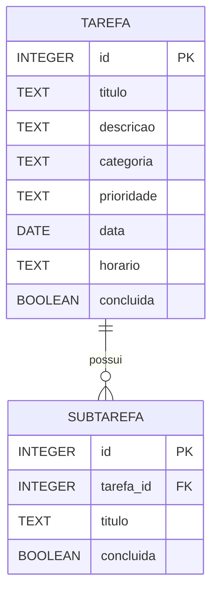

# CanDo

## Sobre o app

O **CanDo** é um aplicativo mobile de organização de tarefas diárias. O usuário pode cadastrar as tarefas que deseja realizar, organizá-las por categoria e prioridade e acompanhar seu progresso ao longo do dia.

A proposta do aplicativo é oferecer uma experiência simples e intuitiva para ajudar o usuário a visualizar suas atividades, controlar o que já foi realizado e dividir tarefas maiores em **subtarefas**, facilitando o acompanhamento do progresso.

### Funcionalidades essenciais

* [x] Criar tarefa
* [x] Listar e visualizar tarefas
* [ ] Editar tarefa
* [x] Marcar tarefa como concluída
* [ ] Excluir tarefa
* [x] Definir categoria para a tarefa
* [x] Definir prioridade da tarefa
* [ ] Definir data e horário para a tarefa
* [x] Criar subtarefas dentro de uma tarefa
* [x] Marcar subtarefas como concluídas
* [x] Visualizar o progresso diário
* [x] Visualizar o progresso das subtarefas

### Funcionalidades adicionais (trabalhos futuros)

* [ ] Histórico detalhado de tarefas concluídas
* [ ] Notificações e lembretes
* [ ] Personalização das categorias
* [ ] Tema escuro
* [ ] Estatísticas mais detalhadas de produtividade

## Protótipos de tela

Os protótipos do **CanDo** foram desenvolvidos no Figma, seguindo um Design System próprio, com definição de cores, tipografia, espaçamentos, componentes e estados da interface.

[Protótipos - CanDo (Figma)](https://www.figma.com/design/LBz7bRwmiWOFjMUBxhAk5m/CanDo?node-id=0-1&t=MYgJB43Y0SSDIezh-1)

### Principais telas

* Splash Screen
* Tela inicial / Hoje (`app/index.tsx`)
* Criar tarefa (`app/new-task.tsx`)
* Editar tarefa
* Detalhes da tarefa (`app/task-details.tsx`)
* Todas as tarefas
* Progresso
* Perfil / Configurações
* Estado vazio (Empty State)

### Fluxo principal

```text
Splash
   ↓
Hoje
   ↓
Nova tarefa
   ↓
Preencher tarefa
   ↓
Adicionar tarefa
   ↓
Tarefa aparece na lista
   ↓
Detalhes da tarefa
   ↓
Adicionar subtarefas (opcional)
   ↓
Marcar tarefa ou subtarefas como concluídas
   ↓
Progresso atualizado
```


## Modelagem do banco de dados (SQLite)

O aplicativo utilizará SQLite para armazenar as tarefas e suas subtarefas.




## Atualizações desde o último checkpoint

Neste checkpoint, foi desenvolvida a base arquitetural e visual do CanDo, implementando a navegação com Expo Router, estilização alinhada ao protótipo do Figma, dados mockados e componentes reutilizáveis.

### Recursos aplicados dos módulos anteriores

* **Expo Router:** navegação entre telas via `Stack` e roteamento em `app/` com `useRouter`.
* **TypeScript:** tipagem do modelo de dados (`Task`, `Subtask`) e das props dos componentes.   
* **Google Fonts (Inter):** tipografia do Figma carregada com `@expo-google-fonts/inter`.
* **Expo Vector Icons:** ícones de navegação, status e botões com `Ionicons`.
* **Theme / Design Tokens:** centralização de cores e estilos em `constants/theme.ts`.
* **Mocks de dados:** dados fake em `mocks/types.ts` para popular as telas no checkpoint.

### Boas práticas na criação de componentes

* **Responsabilidade Única (SRP):** cada componente tem apenas uma função visual isolada (ex: `TaskCard` para tarefas, `DailyProgressCard` para o progresso, `EmptyState` para estado vazio).
* **Componentes Apresentacionais (Dumb Components):** recebem dados e emitem ações via `props` (`onPress`, `onToggleComplete`), sem regra de negócio embutida.
* **Props Tipadas com TypeScript:** uso de `interfaces` em cada componente garantindo consistência e prevenindo erros.
* **Modularidade e Separação de Pastas:** divisão clara entre rotas (`app/`), componentes (`components/`), tipos (`types/`) e dados (`mocks/`).

## Planejamento de sprints

O desenvolvimento do **CanDo** está planejado em 8 sprints:

### Sprint 1 — Planejamento e prototipação
* [x] Definir as funcionalidades essenciais do aplicativo
* [x] Definir o fluxo de navegação
* [x] Criar as telas principais no Figma seguindo Design System
* [x] Criar o protótipo interativo
* [x] Revisar a experiência de navegação

### Sprint 2 — Estrutura inicial e roteamento (Checkpoint Atual)
* [x] Criar o projeto utilizando Expo e TypeScript
* [x] Configurar o repositório GitHub com branch main e fluxo de PRs
* [x] Configurar o Expo Router com `app/_layout.tsx`
* [x] Configurar tipografia Inter com `@expo-google-fonts/inter`
* [x] Configurar Design Tokens centralizados em `constants/theme.ts`
* [x] Organizar a estrutura de pastas do projeto

### Sprint 3 — Composição de telas e componentes reutilizáveis (Checkpoint Atual)
* [x] Desenvolver a tela inicial **Hoje** (`app/index.tsx`)
* [x] Implementar componentes reutilizáveis na pasta `components/`
* [x] Desenvolver a tela **Nova Tarefa** (`app/new-task.tsx`) com formulário e subtarefas
* [x] Desenvolver a tela **Detalhes da Tarefa** (`app/task-details.tsx`) com subtarefas interativas
* [x] Popular as 3 telas com dados mockados (`mocks/types.ts`)
* [x] Implementar navegação funcional de ida e volta entre as 3 telas

### Sprint 4 — Modelagem e persistência com SQLite
* [ ] Configurar SQLite no Expo
* [ ] Criar tabelas `TAREFA` e `SUBTAREFA`
* [ ] Implementar operações de CRUD de tarefas (inserir, listar, editar e excluir)
* [ ] Implementar persistência e alternância de conclusão das subtarefas
* [ ] Conectar banco de dados às telas existentes

### Sprint 5 — Validações e gerenciamento de estado
* [ ] Implementar validação dos campos na criação de tarefas
* [ ] Implementar sincronização de estado entre telas
* [ ] Implementar filtros de tarefas por categoria e status
* [ ] Atualização reativa da barra de progresso diário

### Sprint 6 — Funcionalidades adicionais e refinamento
* [ ] Desenvolver telas complementares (Todas as tarefas e Progresso)
* [ ] Implementar filtros de busca por data
* [ ] Implementar feedback visual (mensagens e animações suaves)
* [ ] Testes de responsividade em diferentes telas

### Sprint 7 — Testes e estabilização
* [ ] Testar fluxo completo de tarefas e subtarefas
* [ ] Testar persistência dos dados ao reabrir o app
* [ ] Correção de bugs de layout e navegação
* [ ] Validação com `expo-doctor` e `npx tsc --noEmit`

### Sprint 8 — Finalização e entrega
* [ ] Ajustes finais de interface conforme protótipo do Figma
* [ ] Atualização final da documentação
* [ ] Gravação do vídeo final de apresentação
* [ ] Entrega da versão final do aplicativo

## Como executar o projeto

### Pré-requisitos
* Node.js (v18 ou superior)
* npm ou yarn
* Expo Go no celular (opcional)

### Instalação e execução
```bash
# 1. Clone o repositório
git clone https://github.com/larigm/can-do.git

# 2. Acesse a pasta
cd can-do

# 3. Instale as dependências
npm install

# 4. Inicie o servidor
npx expo start
```
* Pressione **`w`** para abrir no navegador web.
* Ou leia o QR Code no app **Expo Go** no celular.
