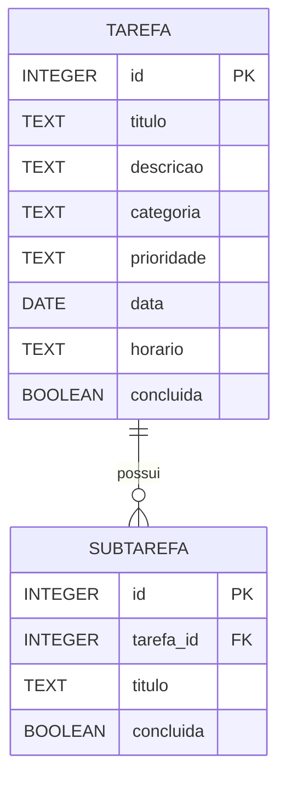

# CanDo

## Sobre o app

O **CanDo** é um aplicativo mobile de organização de tarefas diárias. O usuário pode cadastrar as tarefas que deseja realizar, organizá-las por categoria e prioridade e acompanhar seu progresso ao longo do dia.

A proposta do aplicativo é oferecer uma experiência simples e intuitiva para ajudar o usuário a visualizar suas atividades, controlar o que já foi realizado e dividir tarefas maiores em **subtarefas**, facilitando o acompanhamento do progresso.

### Funcionalidades essenciais

* [x] Listar e visualizar tarefas
* [x] Visualizar o progresso diário
* [x] Visualizar o progresso das subtarefas
* [x] Marcar subtarefas como concluídas (interativo na interface)
* [ ] Criar tarefa (persistência no banco de dados)
* [ ] Editar tarefa (persistência no banco de dados)
* [ ] Excluir tarefa (persistência no banco de dados)
* [ ] Definir categoria para a tarefa
* [ ] Definir prioridade da tarefa
* [ ] Definir data e horário para a tarefa
* [ ] Criar subtarefas dentro de uma tarefa

### Funcionalidades adicionais (trabalhos futuros)

* [ ] Histórico detalhado de tarefas concluídas
* [ ] Notificações e lembretes
* [ ] Personalização das categorias
* [ ] Tema escuro
* [ ] Estatísticas mais detalhadas de produtividade

## Protótipos de tela

Os protótipos do **CanDo** foram desenvolvidos no Figma, seguindo um Design System próprio, com definição de cores, tipografia, espaçamentos, componentes e estados da interface.

[Protótipos - CanDo (Figma)](https://www.figma.com/design/LBz7bRwmiWOFjMUBxhAk5m/CanDo?node-id=0-1&t=MYgJB43Y0SSDIezh-1)

### Principais telas

* Splash Screen
* Tela inicial / Hoje
* Criar tarefa (Nova tarefa)
* Editar tarefa
* Detalhes da tarefa
* Todas as tarefas
* Progresso
* Perfil / Configurações
* Estado vazio (Empty State)

### Fluxo principal

```text
Splash
   ↓
Hoje (index)
   ↓
Nova tarefa (new-task)
   ↓
Preencher tarefa e subtarefas
   ↓
Adicionar tarefa
   ↓
Tarefa aparece na lista
   ↓
Detalhes da tarefa (task-details)
   ↓
Marcar tarefa ou subtarefas como concluídas
   ↓
Progresso atualizado em tempo real
```

## Modelagem do banco de dados (SQLite)

O aplicativo utilizará um banco de dados local **SQLite** para armazenar as tarefas e suas respectivas subtarefas.



## Atualizações desde o último checkpoint

Neste checkpoint, foi desenvolvida a base arquitetural e visual do **CanDo**, implementando a navegação com Expo Router, estilização alinhada ao protótipo do Figma, dados mockados e componentes reutilizáveis.

### Recursos aplicados dos módulos anteriores

* **Expo Router (v58):** Configuração do roteamento baseado em arquivos (`app/`), pilha de navegação nativa (`Stack`) em `app/_layout.tsx` e navegação declarativa com o hook `useRouter` (`router.push` e `router.back`).
* **Multiplataforma (Mobile e Web):** Suporte completo para emuladores, Expo Go (Android/iOS) e navegadores desktop utilizando `react-native-web`.
* **TypeScript Estrito:** Toda a aplicação foi construída em TypeScript, com interfaces bem definidas para o modelo de dados de tarefas (`Task`, `Subtask`, `TaskCategory`, `TaskPriority`) e tipagem estrita de props em todos os componentes.
* **Tipografia Customizada:** Integração da fonte **Inter** (`Inter_400Regular`, `Inter_500Medium`, `Inter_600SemiBold` e `Inter_700Bold`) via `@expo-google-fonts/inter` e `expo-font`, carregada de forma assíncrona no layout raiz com splash indicator.
* **Biblioteca de Ícones Oficiais:** Utilização de `@expo/vector-icons` (`Ionicons`) para garantir consistência visual em botões de ação, menus, checkboxes e estados visuais.
* **Design Tokens / Theme Centralizado:** Criação de `constants/theme.ts` atuando como Single Source of Truth para a paleta de cores (destaque azul `#5B6BFE`, fundos suaves `#EEF2FF`, tons de texto e bordas), espaçamentos e raios de borda.
* **Camada de Mocking Desacoplada:** Criação de `mocks/types.ts` simulando dados reais com tarefas pendentes, tarefas concluídas e subtarefas estruturadas.

### Aplicação das Boas Práticas para Componentes Reutilizáveis

Durante a construção dos componentes em `components/`, foram aplicados rigorosamente os conceitos apresentados na aula:

1. **Princípio da Responsabilidade Única (Single Responsibility Principle - SRP):**
   * Cada componente foi isolado para desempenhar exclusivamente uma única função na interface:
     * `HeaderGreeting`: Responsável somente pela saudação personalizada, data formatada e gatilho de configurações.
     * `WeekDaySelector`: Gerencia exclusivamente a renderização do seletor em pílula dos dias da semana e o feedback visual do dia ativo.
     * `DailyProgressCard`: Calcula percentual e renderiza a barra de progresso visual de forma isolada.
     * `EmptyState`: Exibe a ilustração de prancheta, texto motivacional e CTA de criação para dias sem tarefas.
     * `TaskCard`: Exibe os dados de uma tarefa individual, badge de categoria, indicador de prioridade e checkbox.
     * `FloatingActionButton`: Botão circular de adição flutuante posicionado de forma desacoplada com `zIndex`.
     * `BottomTabBar`: Barra inferior padronizada com navegação contextual entre as seções do app.

2. **Componentes Apresentacionais (Dumb Components) e Desacoplamento:**
   * Os componentes não dependem de regras de negócio acopladas nem manipulam banco de dados diretamente. Eles recebem informações via props e emitem eventos por callbacks (`onToggleComplete`, `onPressDetails`, `onSelectDay`), garantindo que possam ser reutilizados em diferentes telas (como na futura tela "Todas as tarefas").

3. **Props Tipadas com Interfaces TypeScript:**
   * Todos os componentes possuem contratos explícitos de propriedades (ex: `TaskCardProps`, `WeekDaySelectorProps`, `HeaderGreetingProps`), prevenindo erros em tempo de compilação e oferecendo documentação viva no VS Code.

4. **Separação de Preocupações e Arquitetura Limpa:**
   * Separação clara de diretórios: rotas em `app/`, componentes visuais reutilizáveis em `components/`, regras de estilo globais em `constants/`, contratos de dados em `types/` e dados simulados em `mocks/`.

## Planejamento de sprints

O desenvolvimento do **CanDo** está organizado em sprints semanais, contemplando desde a concepção até a entrega final.

### Sprint 1 — Planejamento e prototipação
* [x] Definir as funcionalidades essenciais do aplicativo
* [x] Definir o fluxo de navegação
* [x] Criar as telas principais no Figma seguindo Design System
* [x] Criar o protótipo interativo e componentes de interface
* [x] Revisar a experiência de navegação

### Sprint 2 — Estrutura inicial e roteamento (Checkpoint Atual)
* [x] Criar o projeto utilizando Expo e TypeScript
* [x] Configurar o repositório GitHub com branch main e fluxo de PRs
* [x] Configurar o Expo Router com `app/_layout.tsx`
* [x] Configurar tipografia Inter com `@expo-google-fonts/inter`
* [x] Configurar Design Tokens centralizados em `constants/theme.ts`
* [x] Estruturar pastas (`app/`, `components/`, `mocks/`, `types/`, `constants/`)

### Sprint 3 — Composição de telas e componentes reutilizáveis (Checkpoint Atual)
* [x] Desenvolver a tela inicial **Hoje** (`app/index.tsx`) idêntica ao Figma
* [x] Implementar componentes reutilizáveis (`HeaderGreeting`, `WeekDaySelector`, `DailyProgressCard`, `EmptyState`, `TaskCard`, `FloatingActionButton`, `BottomTabBar`)
* [x] Desenvolver a tela **Nova Tarefa** (`app/new-task.tsx`) com formulário, categorias, prioridades e subtarefas dinâmicas
* [x] Desenvolver a tela **Detalhes da Tarefa** (`app/task-details.tsx`) com subtarefas interativas e botões de ação
* [x] Popular telas com dados mockados (`mocks/types.ts`) e cálculo dinâmico de progresso
* [x] Implementar navegação completa de ida e volta entre as 3 telas

### Sprint 4 — Modelagem e persistência com SQLite
* [ ] Configurar biblioteca local do SQLite no Expo
* [ ] Criar tabelas `TAREFA` e `SUBTAREFA` conforme modelagem ERD
* [ ] Implementar operações de CRUD de tarefas (inserção, listagem, atualização e exclusão)
* [ ] Implementar inserção e alternância de conclusão das subtarefas
* [ ] Integrar operações do banco de dados às telas existentes

### Sprint 5 — Validações e gerenciamento de estado
* [ ] Implementar validação de formulários na criação de tarefas
* [ ] Integrar estado global ou context para sincronização entre telas
* [ ] Implementar filtros de tarefas por categoria e status (concluídas/pendentes)
* [ ] Implementar atualização reativa do progresso diário

### Sprint 6 — Funcionalidades adicionais e refinamento
* [ ] Desenvolver tela "Todas as tarefas" e tela "Progresso"
* [ ] Implementar filtros de busca por data
* [ ] Implementar feedback visual (snackbars/toasts e animações suaves)
* [ ] Testes de layout em diferentes tamanhos de tela (Android, iOS e Web)

### Sprint 7 — Testes e estabilização
* [ ] Testar fluxo completo de criação, visualização e conclusão de tarefas e subtarefas
* [ ] Testar persistência dos dados após fechar e reabrir o app
* [ ] Correção de possíveis inconsistências de layout e bugs de navegação
* [ ] Verificação com `expo-doctor` e `tsc --noEmit`

### Sprint 8 — Finalização e entrega
* [ ] Revisão geral do alinhamento com o protótipo do Figma
* [ ] Atualização final do README e documentação
* [ ] Gravação do vídeo final do projeto
* [ ] Entrega da versão final do CanDo

## Como executar o projeto

### Pré-requisitos
* Node.js (v18 ou superior)
* npm ou yarn
* Aplicativo **Expo Go** instalado no celular (opcional para teste físico)

### Instalação e execução
```bash
# 1. Clone o repositório
git clone https://github.com/larigm/can-do.git

# 2. Acesse a pasta do projeto
cd can-do

# 3. Instale as dependências
npm install

# 4. Inicie o servidor Expo
npx expo start
```

* Para abrir no **Navegador Web**: pressione a tecla **`w`** no terminal.
* Para abrir no **Celular (Android ou iOS)**: abra o app **Expo Go** e escaneie o QR Code exibido no terminal.
